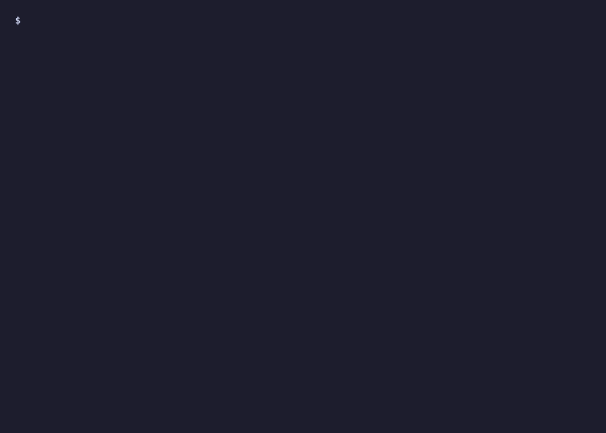
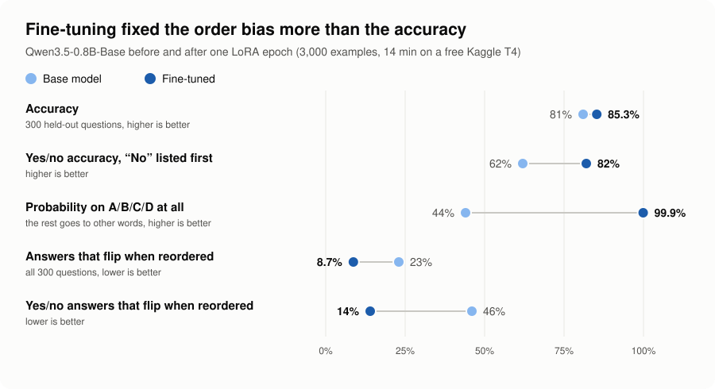
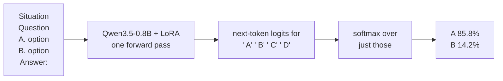

<div align="center">

# decision-0.8b

**Microsoft shipped a decision model on Oct 9. No weights, no recipe, API only.<br>So here is an open one: 0.8B parameters, trained in 14 minutes on a free Kaggle GPU.**




</div>

A decision model does not chat. You give it a situation, a question and fixed options. It reads them **once** and returns a probability for every option. No text generation, no output parsing, no retries. One forward pass, about 90 ms on an M5 Mac.

```bash
python decide.py "Should the agent ask the user before deleting 4,000 emails?" --options Yes No
```
```
  Yes  █████████████████████░░░░░░░░░   69.1%
  No   █████████░░░░░░░░░░░░░░░░░░░░░   30.9%
```

## Small models like the letter A

Before any training, I asked stock Qwen3.5-0.8B 100 yes/no questions. Then I asked the **exact same questions** with the two options swapped.

| | "Yes" listed as A | "No" listed as A |
|---|---|---|
| Model picks option A | 81 / 100 | 59 / 100 |
| Accuracy | 76% | **62%** |

The right answer was "Yes" 67 times, so swapping two lines pushed it **below the "always say Yes" baseline**. 46% of its yes/no answers flipped when nothing but the order changed. The knowledge is in there. The model was half answering the question and half answering the letter.

Then one epoch of LoRA, with the option order reshuffled every time an example is seen:

<picture>
  <source media="(prefers-color-scheme: dark)" srcset="assets/results-dark.svg">
  
</picture>

| 300 held-out questions | Base | Fine-tuned |
|---|---|---|
| Accuracy | 81.0% | **85.3%** |
| Right when 80%+ sure | 96.2% (130 Qs) | 93.4% (212 Qs) |
| Answers that flip when options are reordered | 23.0% | **8.7%** |
| Yes/no accuracy, "No" listed first | 62% | **82%** |
| Calibration error (ECE) | 0.067 | **0.028** |
| Probability on A/B/C/D at all | 0.44 | **0.999** |

**Honest read.** The accuracy gain is borderline on 300 questions (26 fixed, 13 broken, McNemar p = 0.053). Science stayed flat at 82%, because fine-tuning taught the model *how* to answer, not new facts. The order-bias fix is the real result.

## One space broke it. Accuracy did not notice.

Every prompt ends in `Answer:`, and the model learned that the next token is ` A` (space and letter, a single token). Add one trailing space to the prompt and re-run:

| | `Answer:` | `Answer:␣` |
|---|---|---|
| Accuracy | 85.3% | 84.7% |
| Probability on A/B/C/D at all | 99.9% | **20.1%** |

Accuracy says everything is fine. Meanwhile 80% of the probability now goes to a token nobody reads. Track only accuracy and you ship this. Track the mass.

## Why only one layer trains on a Mac

Qwen3.5 is a hybrid: 18 of its 24 layers are Gated DeltaNet (linear attention), 6 are full attention. In mlx-lm, backprop through a DeltaNet layer runs a token-by-token loop that keeps a 16 × 128 × 128 state **for every token, in every layer**:

```
8 sequences × 450 tokens × 16 heads × 128 × 128 × 4 bytes × 18 layers ≈ 68 GB
```

On a 16 GB M5 the first run got OOM-killed (exit 137). So the MLX trainer here freezes everything below the top layer and runs it on the fast forward-only kernel: 2.4 GB, about 1 s per step. PyTorch's implementation runs DeltaNet in 64-token chunks and stores one state per chunk instead of per token, so all 24 layers fit on a free Kaggle T4 at a 6.2 GB peak.

## How it works



- **Readout:** the next-token logits at `Answer:`, restricted to the option letters and softmaxed. Same readout before and after training, so the only thing that changes is the weights.
- **Training:** cross-entropy on that single answer token. LoRA r=16, alpha=32 on every linear layer of all 24 blocks (10.8M trainable params, 1.4%). AdamW 2e-4 with cosine decay, 375 steps of 8 examples, fp32 on a T4, 14 minutes.
- **Data:** 1,000 examples each from BoolQ (yes/no), ARC-Easy (4-option science) and AG News (4-way topic). Tested on 100 of each from their held-out splits, never trained on. The option order is reshuffled every time an example is seen, so position carries no signal.
- **Eval:** accuracy, log loss, Brier, ECE, accuracy at 80%+ confidence, flip rate under a random reordering, and probability mass on the letters. Microsoft says Decision-1 is evaluated with option order varied. This measures exactly that.

## Run it

```bash
git clone https://github.com/saksham10arora-dotcom/decision-0.8b && cd decision-0.8b
pip install -r requirements.txt
python decide.py --demo
python decide.py "Which team should handle this ticket?" \
    --situation "I was charged twice for my October subscription and need one refunded." \
    --options Billing "Bug report" "Feature request"
```

The LoRA adapter (22 MB, fp16) ships in `adapter/`. The base model downloads from Hugging Face on first run. Works on CUDA, Apple Silicon or CPU.

## Train it yourself, free

1. `python prep_data.py` rebuilds `data/{train,val,test}.jsonl` (3,000 / 300 / 300), split before anything else touches it.
2. Upload `data/` as a private Kaggle dataset (`kaggle datasets create -p data`) and point `dataset_sources` in `kaggle/kernel-metadata.json` at it.
3. Set `MODE = "base"` or `MODE = "train"` at the top of `kaggle/run.py`, then `kaggle kernels push -p kaggle`.

On a Mac with MLX: `python train.py` (top layer only, see above), then `python eval.py --adapter adapters`.

## What this is not

- **Not Decision-1.** Microsoft published no weights, method or numbers, so there is nothing to benchmark against. Same idea, built from scratch, 11× smaller.
- **Not a knowledge upgrade.** It knows what Qwen3.5-0.8B knows. Fine-tuning fixed the format, the order bias and the calibration.
- **Not a big sample.** 300 test questions. The accuracy gain needs a larger test set before anyone should trust it.
- **Not cherry-picked.** The demo shows it giving an Nvidia earnings headline 60% Science/Technology and 38% Business. It is unsure, and it says so.
- **Not good at sarcasm.** "Oh great, another update that deletes my settings." Sarcastic? It says 58% no.

## Files

| File | What it does |
|---|---|
| `decide.py` | ask it anything with 2 to 4 options |
| `adapter/` | the trained LoRA weights (fp16) |
| `kaggle/run.py` | the main pipeline: score base, LoRA-train all layers, score tuned |
| `prep_data.py` | builds the splits from BoolQ, ARC-Easy and AG News |
| `decision.py`, `eval.py`, `train.py` | the MLX version for Apple Silicon |
| `assets/` | chart generator, demo tape (`vhs assets/demo.tape`) |

## License

Code: MIT. The adapter is a derivative of [Qwen3.5-0.8B-Base](https://huggingface.co/Qwen/Qwen3.5-0.8B-Base) (Apache 2.0). Training data is not redistributed: `prep_data.py` rebuilds it from the original datasets under their own licenses.
